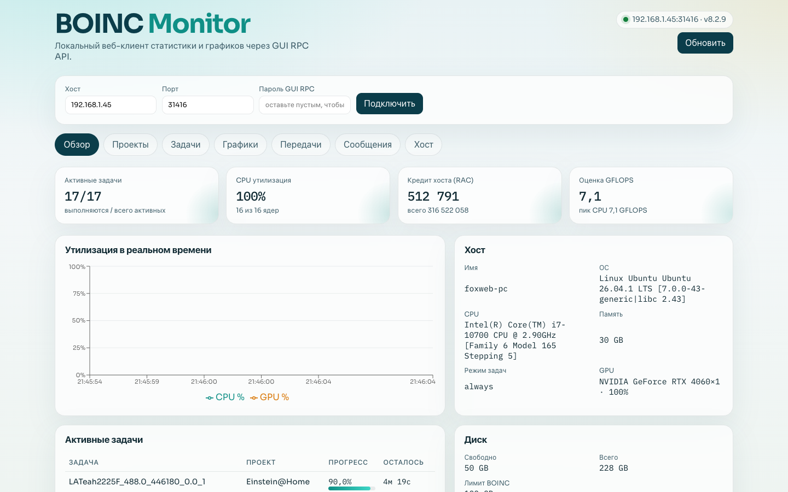
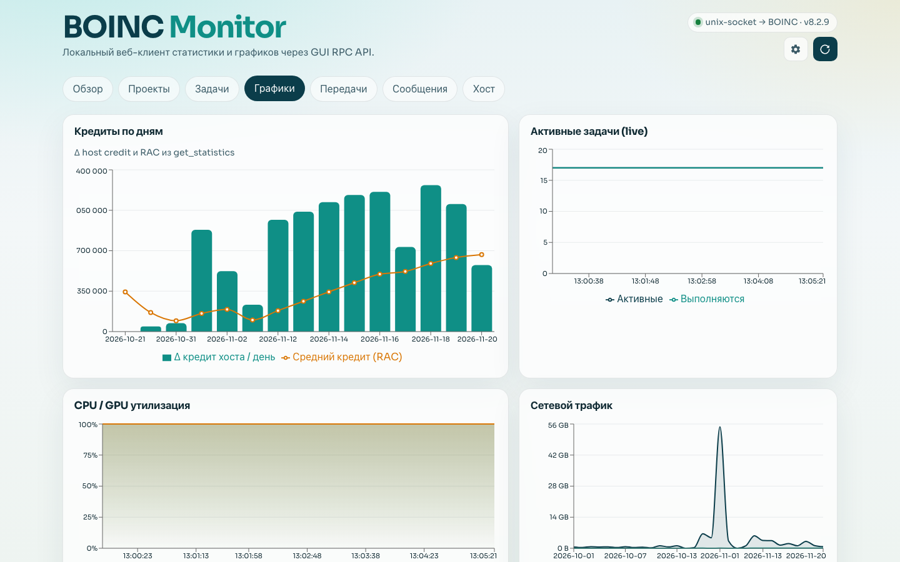

# BOINC Monitor

Веб-клиент статистики BOINC через GUI RPC. Запуск **только через Docker**.





## Запуск

Только Docker. На машине с BOINC:

```bash
git clone git@github.com:foxweb/boinc-web-client.git ~/boinc-web-client
cd ~/boinc-web-client
cp .env.example .env   # задайте BOINC_PASSWORD
docker compose up -d --build
```

Браузер: **http://\<хост\>:8080**  
(на foxweb-pc: http://192.168.1.45:8080)

```bash
docker compose logs -f    # логи
docker compose down       # стоп
```

Контейнеры с `restart: unless-stopped` поднимаются вместе с Docker после reboot.

## Переменные окружения

| Переменная | По умолчанию | Описание |
|---|---|---|
| `BOINC_PASSWORD` | — | пароль GUI RPC (обязателен) |
| `BOINC_PORT` | `31416` | порт GUI RPC на хосте |
| `PORT` | `8080` | HTTP-порт веб-UI |

UI публикуется Docker-портом `:8080` (проходит UFW). GUI RPC: sidecar (`network_mode: host`) проксирует localhost BOINC в unix-socket на shared volume.

## Что показывает

Host / CC status, проекты, задачи, передачи, сообщения, диск, дневные кредиты/RAC, сетевой трафик, live CPU/GPU и активные задачи.

RPC: `exchange_versions`, `get_host_info`, `get_cc_status`, `get_project_status`, `get_results`, `get_file_transfers`, `get_messages`, `get_disk_usage`, `get_statistics`, `get_daily_xfer_history`.

## Опционально: systemd (нужен sudo)

```bash
sudo cp deploy/boinc-monitor.service /etc/systemd/system/
sudo systemctl daemon-reload
sudo systemctl enable --now boinc-monitor.service
```
